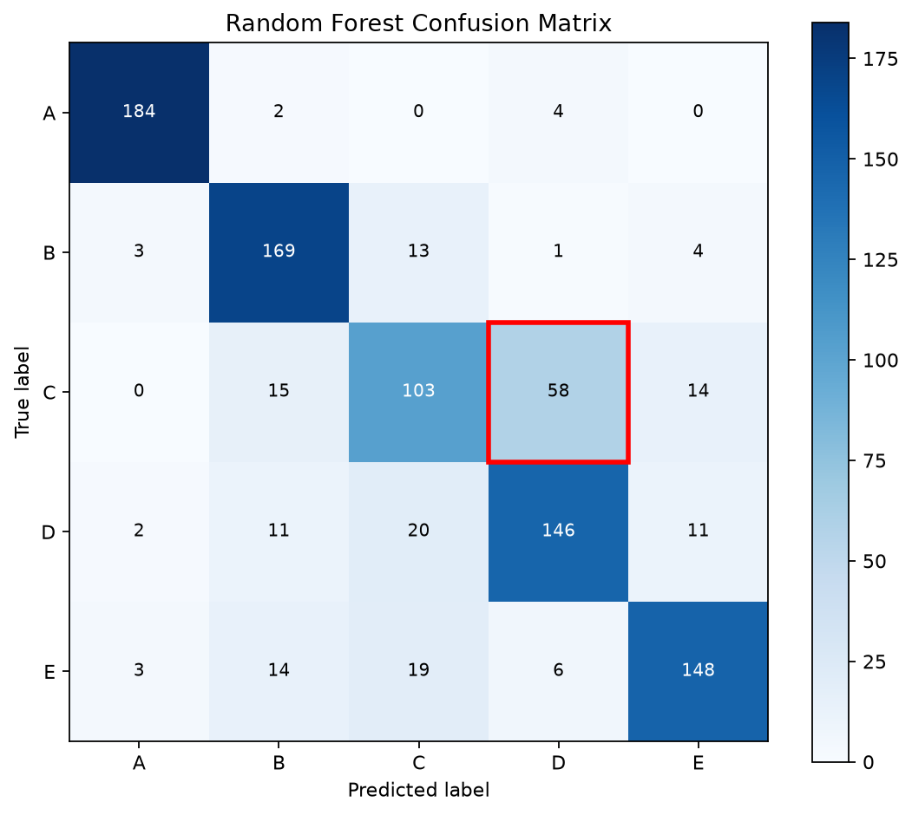
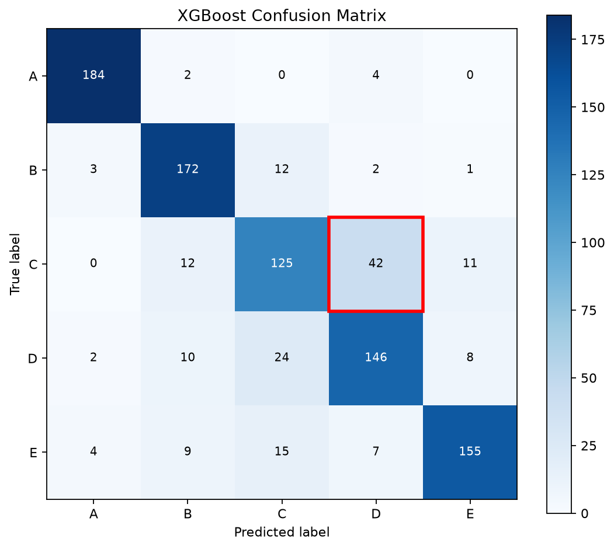

# sEMG Step 2: 시간영역 특징 기반 모델 비교

## 1. 프로젝트 개요

이 프로젝트에서는 sEMG 신호에서 시간영역 특징을 추출하고 세 가지 머신러닝 모델의 분류 성능을 비교하였다.

비교 모델은 SVM, Random Forest, XGBoost이다. 동일한 학습 데이터와 테스트 데이터를 이용해 Accuracy, Precision, Recall, F1-score를 측정하였으며 혼동행렬을 통해 클래스별 오분류를 분석하였다. 추가로 파일 단위 5-fold 교차검증과 대응표본 t-검정을 수행하여 모델별 성능과 차이를 확인하였다.

## 2. 데이터 및 전처리

### 2.1 데이터 구성

| 항목 | 내용 |
|---|---|
| 데이터 종류 | sEMG CSV 파일 |
| 원본 파일 수 | 250개 |
| 클래스 | A, B, C, D, E |
| 채널 수 | 2개 |
| 샘플링 주파수 | 1,000 Hz |
| 분석 구간 | 1초부터 3초까지 |
| 윈도우 길이 | 200 ms |
| 윈도우 이동 간격 | 100 ms |
| 최종 특징 수 | 10개 |

### 2.2 전처리 과정

전처리는 다음 순서로 진행하였다.

1. **필터링:** 60 Hz 노치 필터와 20~450 Hz 대역통과 필터를 적용하였다.
2. **구간 추출:** 원본 신호에서 1초부터 3초까지의 2초 구간을 추출하였다.
3. **윈도우 생성:** 200 ms 길이의 윈도우를 100 ms 간격으로 이동하며 생성하였다.
4. **특징 추출:** RMS, MAV, WL, ZC, SSC의 시간영역 특징을 계산하였다.
5. **데이터 분할:** 윈도우 생성 후 무작위로 나누는 대신 원본 파일 단위로 학습 데이터와 테스트 데이터를 분리하였다.
6. **표준화:** 학습 데이터에서 계산한 평균과 표준편차를 이용해 특징을 표준화하였다.

RMS는 신호의 실효값, MAV는 평균 절댓값, WL은 파형의 변화량, ZC는 영점 교차 횟수, SSC는 기울기 부호 변화 횟수를 나타낸다.

각 채널에서 5개 특징을 계산하므로 최종 특징 벡터는 총 10개 값으로 구성된다.

### 2.3 데이터 분할 결과

| 항목 | 학습 데이터 | 테스트 데이터 |
|---|---:|---:|
| 원본 파일 수 | 200개 | 50개 |
| 윈도우 수 | 3,800개 | 950개 |
| 클래스별 윈도우 수 | 760개 | 190개 |
| 특징 수 | 10개 | 10개 |

전체 데이터는 250개 파일에서 생성한 4,750개 윈도우로 구성된다. 하나의 원본 파일에서 생성된 윈도우가 학습 데이터와 테스트 데이터에 동시에 포함되지 않도록 파일 단위로 분리하였다.

## 3. 코드 설명

### 3.1 주요 코드 파일

| 파일 | 설명 |
|---|---|
| `stage1_filter.py` | sEMG 신호 필터링 |
| `stage2_segment.py` | 분석 구간 추출 |
| `stage3_window.py` | 슬라이딩 윈도우 생성 |
| `stage4_features.py` | 시간영역 특징 추출 |
| `stage5_split_dataset.py` | 원본 파일 단위 학습·테스트 데이터 분할 |
| `stage6_scale_dataset.py` | 특징 표준화 및 데이터셋 저장 |
| `week3_holdout.py` | SVM, Random Forest, XGBoost의 홀드아웃 평가 및 혼동행렬 생성 |
| `week3_cv_stats.py` | 파일 단위 5-fold 교차검증 및 대응표본 t-검정 |

### 3.2 주요 폴더 및 결과 파일

| 경로 | 설명 |
|---|---|
| `data/data/` | 클래스 A~E의 원본 CSV 파일 |
| `week2_results/dataset.npz` | 시간영역 특징 기반 학습·테스트 데이터 |
| `week3_results/metrics_holdout.csv` | 홀드아웃 성능 비교표 |
| `week3_results/classification_reports.txt` | 클래스별 분류 평가 보고서 |
| `week3_results/confusion_svm.png` | SVM 혼동행렬 |
| `week3_results/confusion_random_forest.png` | Random Forest 혼동행렬 |
| `week3_results/confusion_xgboost.png` | XGBoost 혼동행렬 |
| `week3_results/cv_fold_results.csv` | 폴드별 교차검증 결과 |
| `week3_results/cv_summary.csv` | 교차검증 평균 및 표준편차 |
| `week3_results/paired_ttests.csv` | 대응표본 t-검정 결과 |
| `week3_results/statistical_analysis.txt` | 통계 검정 해석 |
| `week3_results/run_info.txt` | 실행 환경 및 데이터 정보 |

## 4. 실행 방법

### 4.1 실행 환경

- 운영체제: Windows
- Python: 3.14.2
- 실행 장치: CPU

### 4.2 가상환경 및 라이브러리 설치

프로젝트 폴더에서 가상환경을 생성하고 활성화한다.

```powershell
python -m venv .venv
.\.venv\Scripts\Activate.ps1
```

필요한 라이브러리를 설치한다.

```powershell
python -m pip install numpy scipy scikit-learn matplotlib xgboost
```

### 4.3 모델 평가 실행

전처리된 데이터셋인 `week2_results/dataset.npz`가 준비되어 있다면 다음 명령어로 홀드아웃 평가를 수행한다.

```powershell
python week3_holdout.py
```

이후 파일 단위 5-fold 교차검증과 통계 검정을 수행한다.

```powershell
python week3_cv_stats.py
```

실험이 끝나면 성능 비교표, 혼동행렬, 교차검증 결과와 통계 검정 결과가 `week3_results/` 폴더에 저장된다.

원본 신호부터 다시 처리하려면 원본 CSV 데이터와 필요한 실행 환경을 준비한 뒤 `stage1_filter.py`부터 `stage6_scale_dataset.py`까지 순서대로 실행한다.

## 5. 모델 성능 비교

### 5.1 홀드아웃 테스트 결과

Precision, Recall, F1-score는 각 클래스를 동일하게 취급하는 macro 평균으로 계산하였다.

| Model | Accuracy | Precision | Recall | F1-score |
|---|---:|---:|---:|---:|
| SVM | 81.16% | 80.86% | 81.16% | 80.89% |
| Random Forest | 78.95% | 78.78% | 78.95% | 78.62% |
| XGBoost | **82.32%** | **82.29%** | **82.32%** | **82.22%** |

홀드아웃 테스트에서 XGBoost가 네 가지 평가 지표 모두 가장 높은 성능을 보였다. SVM은 Accuracy 81.16%를 기록하였고 Random Forest는 세 모델 중 가장 낮은 Accuracy와 F1-score를 나타냈다.

### 5.2 계산 비용 비교

| Model | 학습 시간 | 샘플당 추론 시간 |
|---|---:|---:|
| SVM | 0.274초 | 0.2463 ms |
| Random Forest | 0.524초 | 0.0550 ms |
| XGBoost | 6.086초 | 0.0359 ms |

현재 실행 환경에서는 XGBoost의 학습 시간이 가장 길었지만 샘플당 추론 시간은 가장 짧았다. 따라서 모델을 선택할 때는 분류 성능뿐 아니라 학습 비용과 실제 사용 환경에서 요구되는 추론 속도도 함께 고려해야 한다.

위 시간은 `semg2`에서 수행한 측정 결과이며 다른 하드웨어나 라이브러리 환경에서는 달라질 수 있다.

### 5.3 5-fold 교차검증 결과

전체 250개 원본 파일을 이용하여 파일 단위 층화 5-fold 교차검증을 수행하였다. 각 폴드에서는 200개 파일을 학습에 사용하고 50개 파일을 검증에 사용하였다.

| Model | Fold 1 | Fold 2 | Fold 3 | Fold 4 | Fold 5 | 평균 정확도 ± 표준편차 |
|---|---:|---:|---:|---:|---:|---:|
| SVM | 79.37% | 80.74% | 81.68% | 80.11% | 78.84% | 80.15 ± 1.00% |
| Random Forest | 79.79% | 80.53% | 81.05% | 78.00% | 78.63% | 79.60 ± 1.14% |
| XGBoost | 82.84% | 83.26% | 83.16% | 80.11% | 81.16% | **82.11 ± 1.26%** |

Macro F1의 평균과 표준편차는 다음과 같다.

| Model | Macro F1 평균 ± 표준편차 |
|---|---:|
| SVM | 0.7988 ± 0.0105 |
| Random Forest | 0.7940 ± 0.0122 |
| XGBoost | **0.8199 ± 0.0130** |

5-fold 교차검증에서도 XGBoost가 평균 정확도와 Macro F1 모두 가장 높은 결과를 나타냈다.

다만 이 교차검증은 원래의 학습 데이터와 테스트 데이터를 합친 전체 250개 파일을 대상으로 수행하였다. 따라서 기존 홀드아웃 테스트와 완전히 독립적인 외부 평가 결과는 아니다.

## 6. 통계 검정

폴드별 정확도를 이용하여 모델 간 대응표본 t-검정을 수행하였다. 유의수준은 0.05로 설정하였다.

| 모델 비교 | t 통계량 | p-value | 판정 |
|---|---:|---:|---|
| SVM vs Random Forest | 1.2904 | 0.266464 | 유의한 차이를 검출하지 못함 |
| SVM vs XGBoost | -3.3537 | 0.028472 | 유의함 |
| Random Forest vs XGBoost | -13.6502 | 0.000167 | 유의함 |

보정하지 않은 p-value를 기준으로 SVM과 XGBoost, Random Forest와 XGBoost 사이에서는 유의수준 0.05에서 통계적으로 유의한 차이가 나타났다. SVM과 Random Forest 사이에서는 유의한 차이를 검출하지 못했다.

다만 세 쌍의 비교에 대한 다중비교 보정은 적용하지 않았다. 또한 교차검증 폴드의 학습 데이터는 서로 겹치기 때문에 검정 결과를 해석할 때 이러한 한계를 고려해야 한다. 유의한 차이를 검출하지 못했다는 것이 두 모델의 성능이 동등하다는 뜻은 아니다.

## 7. Confusion Matrix 분석

혼동행렬에서 행은 실제 클래스이고 열은 예측 클래스이다. 대각선은 올바르게 분류한 데이터이며 대각선 바깥의 값은 오분류된 데이터이다.

### 7.1 SVM


- 가장 높은 재현율을 보인 클래스: A, 97.89%
- 최대 오분류 쌍: C → D, 35개

SVM은 A 클래스에서 가장 높은 재현율을 보였다. 그러나 실제 C 클래스의 데이터 35개가 D 클래스로 잘못 분류되었다.

### 7.2 Random Forest



- 가장 높은 재현율을 보인 클래스: A, 96.84%
- 최대 오분류 쌍: C → D, 58개

Random Forest 역시 A 클래스의 재현율이 가장 높았다. 세 모델 중 C를 D로 오분류한 횟수가 가장 많았으며 전체 Accuracy와 Macro F1도 가장 낮았다.

### 7.3 XGBoost



- 가장 높은 재현율을 보인 클래스: A, 96.84%
- 최대 오분류 쌍: C → D, 42개

XGBoost는 전체 분류 성능이 가장 높았지만 C와 D 사이의 오분류는 여전히 나타났다. 전체 지표가 높더라도 모든 클래스가 동일하게 잘 분류되는 것은 아니라는 점을 확인할 수 있었다.

### 7.4 오분류 원인 분석

세 모델 모두 C를 D로 오분류하는 경우가 가장 많았다. 두 클래스의 시간영역 특징이 일부 비슷하거나 현재 사용한 특징만으로 두 클래스를 충분히 구분하기 어려웠을 가능성이 있다.

다만 혼동행렬만으로 오분류의 원인을 확정할 수는 없다. 원본 신호와 클래스별 특징 분포를 추가로 비교해야 원인을 더 구체적으로 확인할 수 있다.

## 8. 최종 결과

홀드아웃 테스트에서 XGBoost는 Accuracy 82.32%, Macro F1 82.22%로 가장 높은 성능을 보였다. 5-fold 교차검증에서도 평균 정확도 82.11 ± 1.26%, Macro F1 0.8199 ± 0.0130으로 가장 높은 결과를 나타냈다.

반면 XGBoost는 세 모델 중 학습 시간이 가장 길었다. 세 모델 모두 C를 D로 오분류하는 경향이 나타났으므로 전체 성능 지표뿐 아니라 클래스별 오류도 함께 살펴볼 필요가 있다.

이번 실험을 통해 모델을 비교할 때는 Accuracy만 확인하는 것이 아니라 Precision, Recall, F1-score, 혼동행렬, 교차검증, 통계 검정과 계산 비용을 함께 분석해야 한다는 점을 확인하였다.

## 9. 한계 및 개선 방향

첫째, 현재 실험은 250개 원본 파일과 5개 클래스에 기반한다. 따라서 다른 데이터나 처음 보는 사용자에게도 같은 성능이 나타나는지는 확인하지 못했다.

둘째, 두 채널에서 추출한 10개의 시간영역 특징만 사용하였다. 주파수영역 특징이나 다른 특징 추출 방법을 추가하면 클래스 간 오분류를 줄일 수 있는지 비교할 필요가 있다.

셋째, 5-fold 교차검증은 전체 250개 파일을 대상으로 수행했으며 기존 홀드아웃 테스트에 사용한 파일도 포함한다. 따라서 홀드아웃 평가와 교차검증 결과를 서로 완전히 독립적인 외부 평가로 해석해서는 안 된다.

넷째, 통계 검정은 다섯 폴드의 정확도에 기반하며 다중비교 보정을 적용하지 않았다. 폴드 간 학습 데이터가 겹친다는 점도 결과 해석의 제약이다.

다섯째, 학습 시간과 추론 시간은 현재 CPU 환경에서 측정하였다. 다른 하드웨어에서는 실행 시간과 결과가 달라질 수 있다.

## 10. 재현성 및 결과 파일

실행 환경과 데이터 크기는 `week3_results/run_info.txt`에서 확인할 수 있다. 홀드아웃 성능 비교는 `week3_results/metrics_holdout.csv`, 폴드별 교차검증 결과는 `week3_results/cv_fold_results.csv`, 평균과 표준편차는 `week3_results/cv_summary.csv`에 저장된다.

대응표본 t-검정 결과는 `week3_results/paired_ttests.csv`에서 확인할 수 있으며 검정 결과 해석은 `week3_results/statistical_analysis.txt`에 기록되어 있다.

원본 CSV 데이터, 전처리 코드, 데이터셋, 평가 코드와 결과 파일을 함께 보관하였다. 이를 통해 데이터 준비 과정부터 모델 평가와 결과 확인까지 실험의 주요 단계를 재현할 수 있도록 구성하였다.
